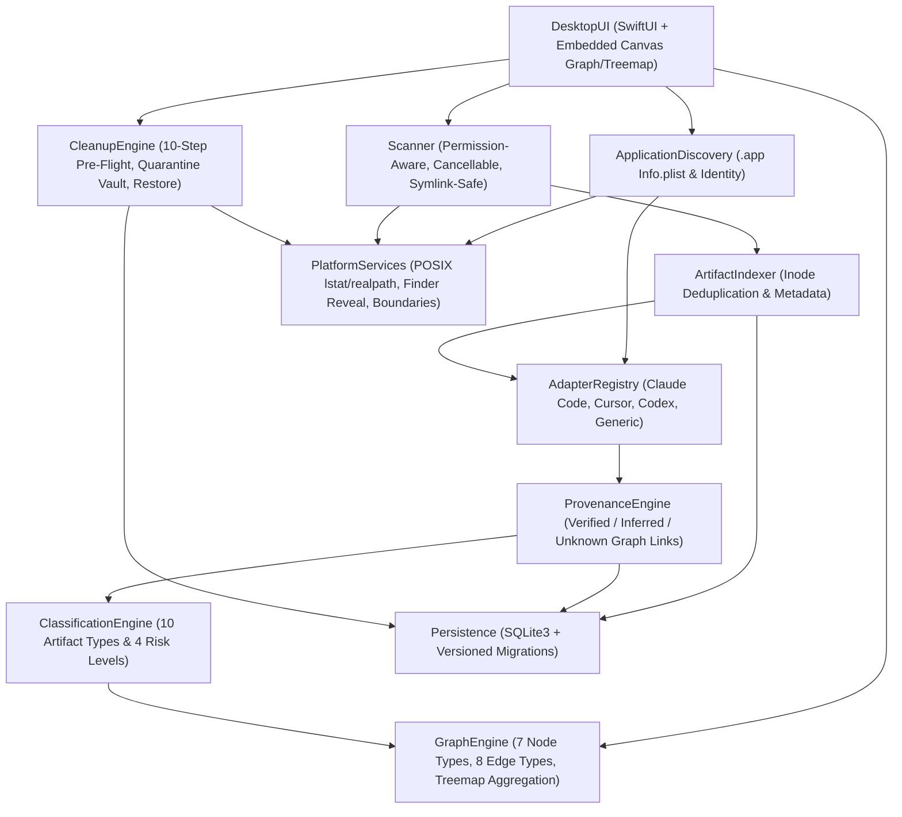

# Artifact Atlas — System Architecture

## 1. Architectural Overview

**Artifact Atlas** is a local-first, privacy-preserving desktop explorer that discovers, traces, visualizes, and safely quarantines filesystem artifacts generated by AI coding assistants and desktop AI applications (`Claude Code`, `Claude Desktop`, `Cursor`, `Codex CLI`, and generic macOS `.app` bundles).

### Core Architectural Tenets

1. **Zero Cloud / Zero Telemetry**: All analysis, session parsing, indexing, and graph rendering execute 100% locally. No external AI APIs or network requests are ever invoked during discovery or classification.
2. **Non-Destructive Discovery**: Scanning and session parsing operate strictly read-only. Dropped `.app` bundles are parsed via bundle plist metadata (`Contents/Info.plist`) and are **never executed**.
3. **Epistemic Honesty in Provenance**: Every link between an AI session/operation and a file is backed by explicit `Evidence` carrying a confidence level (`VERIFIED`, `INFERRED`, or `UNKNOWN`). Timestamp proximity alone never produces a `VERIFIED` conversation-to-file edge.
4. **Multi-Factor Risk Classification**: Cleanup safety is never decided by filename extension alone. The classifier evaluates canonical directory role, Git repository tracking/proximity, provenance confidence, multi-session sharing, hardlink count, and content role.
5. **Reversible Quarantine over Permanent Deletion**: Even when the UI button is labeled **Delete (Move to Quarantine)**, the underlying operation performs a 10-step pre-flight verification and moves eligible files into an isolated, manifest-backed quarantine vault with full conflict-aware restoration.

---

## 2. Dual-Target Hybrid Implementation

To support native macOS execution while enabling full cross-platform portability and deterministic verification on Linux/macOS/Windows CI environments without a macOS GUI host:

1. **Native macOS Target (`Package.swift`, `Sources/ArtifactAtlasCore`, `Sources/ArtifactAtlasApp`, `Tests/ArtifactAtlasCoreTests`)**:
   - Written in Swift 5.10+ targeting macOS 14+ (`SwiftUI`, `Foundation`, `FileManager`, `PropertyListSerialization`, `SQLite3`, and `WKWebView` / `Canvas`).
   - Provides native macOS `.app` drag-and-drop (`NSItemProvider` / `.fileURL`), `NSWorkspace.shared.activateFileViewerSelecting` ("Reveal in Finder"), and native SQLite persistence.
2. **Portable Core + Embedded Desktop UI (`src/` in Node.js 24 ESM + `node:sqlite` + HTML5 Canvas Graph/Treemap Renderer)**:
   - Implements the exact same 11 architectural modules using zero external npm dependencies (relying strictly on Node.js 24 standard library: `node:sqlite`, `node:fs`, `node:crypto`, `node:http`, `node:test`).
   - Parses real macOS `.app/Contents/Info.plist` files, real Claude Code / Cursor / Codex CLI session directories, and real POSIX filesystems (with inode hardlink deduplication and symlink boundary enforcement).
   - Serves the interactive Obsidian-inspired Knowledge Graph, Space Treemap, Provenance Inspector, and Quarantine Vault UI both as the embedded WebView UI for macOS and as a standalone local desktop application.

---

## 3. Component Boundaries (The 11 Core Modules)

### 3.1 `PlatformServices` (`src/platform/` & `Sources/ArtifactAtlasCore/PlatformServices/`)
- Abstracts OS-specific filesystem primitives (`lstat`, `realpath`, inode identity `${dev}:${ino}`, hardlink counts `nlink`, permission checks).
- Enforces **Protected Path Policy**: blocks scanning or cleanup inside `/System`, `/bin`, `/sbin`, `/usr`, `/etc`, `~/.ssh`, `~/.gnupg`, `~/.aws`, `~/.kube`, and `.git` object stores.
- Enforces **Symlink Boundary Policy**: uses `lstat` before traversal; resolves symlink targets with `realpath` and rejects targets escaping the authorized scan roots.

### 3.2 `ApplicationDiscovery` (`src/discovery/` & `Sources/ArtifactAtlasCore/ApplicationDiscovery/`)
- Accepts a dropped `.app` bundle path or workspace directory path.
- Reads `Contents/Info.plist` passively (XML plist and JSON/text fallback) without executing the bundle binary.
- Extracts `CFBundleDisplayName`, `CFBundleName`, `CFBundleIdentifier`, `CFBundleExecutable`, `CFBundleShortVersionString`, `CFBundleVersion`, and developer copyright/signing metadata.
- Queries `AdapterRegistry` to resolve candidate application data roots (`~/Library/Application Support/...`, `~/Library/Caches/...`, `~/Library/Logs/...`, `~/.claude`, `~/.cursor`, `~/.codex`) while treating the dropped `.app` strictly as an identity signal.

### 3.3 `AdapterRegistry` (`src/adapters/` & `Sources/ArtifactAtlasCore/AdapterRegistry/`)
- Pluggable read-only adapter architecture:
  - **`ClaudeCodeAdapter`**: Parses `~/.claude/projects/<slug>/<session>.jsonl` and `~/Library/Application Support/Claude/`. Extracts `sessionId`, `cwd` (workspace path), timestamps, and `tool_use` blocks (`Write`, `Edit`, `MultiEdit`, `NotebookEdit`, `Bash` file outputs) without storing conversation text.
  - **`CursorAdapter`**: Parses `~/Library/Application Support/Cursor/User/workspaceStorage/<id>/workspace.json` and `composerData.json` / session ledgers, plus `CachedData`, `logs`, and `Caches`.
  - **`CodexAdapter`**: Parses `~/.codex/sessions/YYYY/MM/DD/rollout-*.jsonl` function calls (`apply_patch`, `shell`, file writes) and `~/.codex/log`, `~/.codex/tmp`.
  - **`GenericMacOSAppAdapter`**: Fallback adapter for any macOS `.app` bundle; maps standard macOS Library directories (`Caches`, `Logs`, `Saved Application State`, `WebKit`, `Application Support`) with honest `INFERRED` (application-level) or `UNKNOWN` (session-level) provenance.

### 3.4 `Scanner` (`src/scanner/` & `Sources/ArtifactAtlasCore/Scanner/`)
- Asynchronous, cancellable (`AbortSignal` / Swift `Task.isCancelled`) filesystem walker.
- Emits structured progress snapshots (`scannedDirectories`, `scannedFiles`, `discoveredBytes`, `deduplicatedBytes`, `permissionErrors`, `skippedSymlinks`).
- Never follows symlinks outside authorized roots; catches `EACCES`/`EPERM` per entry and records them as structured permission notices.

### 3.5 `ArtifactIndexer` (`src/indexer/` & `Sources/ArtifactAtlasCore/ArtifactIndexer/`)
- Normalizes discovered filesystem entries into canonical `Artifact` records.
- Tracks physical inodes (`${dev}:${ino}`) across the entire scan so hardlinks or overlapping workspace mounts are flagged (`isHardlinked`, `physicalInodeKey`) and never double-counted in storage totals.

### 3.6 `ProvenanceEngine` (`src/provenance/` & `Sources/ArtifactAtlasCore/ProvenanceEngine/`)
- Correlates indexed `Artifact` records with adapter-extracted `Workspace`, `Session`, and `Operation` records.
- Assigns explicit `Evidence` and confidence levels:
  - `VERIFIED`: Direct record in an authoritative session log or tool ledger referencing the canonical path (e.g., `Write` or `apply_patch` tool invocation on `/path/to/file`).
  - `INFERRED`: Indirect structural evidence (e.g., file resides inside an application's dedicated cache/log directory or inside a workspace `dist/` build directory matching a session's active workspace and bounded build operation).
  - `UNKNOWN`: No reliable session or operation link; attached to an explicit `UNKNOWN_ORIGIN` node in the graph.
- Preserves **many-to-many** relationships: if Session A created a file (`CREATED_BY`) and Session B later edited it (`MODIFIED_BY`), both provenance paths and a `SHARED_WITH` indicator are retained.

### 3.7 `ClassificationEngine` (`src/classification/` & `Sources/ArtifactAtlasCore/ClassificationEngine/`)
- Deterministic multi-factor rule engine producing:
  - **Artifact Type**: `REGENERABLE_CACHE`, `TEMP_FILE`, `LOG`, `BUILD_OUTPUT`, `DERIVED_DATA`, `SESSION_HISTORY`, `USER_CONTENT`, `MODEL_DATA`, `CHECKPOINT`, `UNKNOWN`.
  - **Risk Category**: `LOW`, `REVIEW`, `HIGH`, `PROTECTED`.
  - **Human-readable explanation** and **deletion consequence warning**.
- **Safety Invariants**:
  - Filename extension alone never grants `LOW` risk (e.g., `foo.tmp` or `debug.log` inside a project's `src/` folder or modified by an AI coding session is classified as `REVIEW` or `HIGH`, never auto-disposable `LOW`).
  - Session transcripts (`.jsonl`), `.git` metadata, source code, configuration files, credentials (`.env`, `.pem`, keys), model weights (`.gguf`, `.safetensors`, `.onnx`), checkpoints, and multi-session shared files are strictly classified `HIGH` or `PROTECTED`.

### 3.8 `GraphEngine` (`src/graph/` & `Sources/ArtifactAtlasCore/GraphEngine/`)
- Builds the interactive Knowledge Graph (`nodes`, `edges`, `clusters`, `summary`) and the hierarchical Space Treemap (`treemap`).
- **7 Node Types**: `AI_APPLICATION`, `WORKSPACE`, `SESSION`, `OPERATION`, `ARTIFACT`, `ARTIFACT_GROUP`, `UNKNOWN_ORIGIN`.
- **8 Edge Types**: `BELONGS_TO`, `CONTAINS`, `CREATED_BY`, `MODIFIED_BY`, `GENERATED_DURING`, `DERIVED_FROM`, `POSSIBLY_RELATED_TO`, `SHARED_WITH`.
- Computes upstream/downstream provenance subgraphs for any selected node (`traceProvenancePaths(graph, nodeId)`), distinguishing verified vs. inferred vs. unknown hops.
- Computes physical-inode-deduplicated space breakdowns for the Treemap view.

### 3.9 `CleanupEngine` (`src/cleanup/` & `Sources/ArtifactAtlasCore/CleanupEngine/`)
- Executes the **10-step pre-removal verification and quarantine pipeline**:
  1. Re-stat target file on disk (`lstat`).
  2. Compare current `inodeKey`, `sizeBytes`, `mtimeMs`, and `mode` against scan snapshot; abort with `FILE_CHANGED_SINCE_SCAN` if mutated.
  3. Reject symlinks or path traversal (`..` or symlinked ancestor directories).
  4. Reject protected system/credential paths and `PROTECTED` risk classification.
  5. Enforce bulk-cleanup guardrails (blocks bulk quarantine of `HIGH` or `UNKNOWN` items unless individually overridden with explicit acknowledgment).
  6. Check shared dependency indicators (multi-session references, hardlinks).
  7. Generate a structured `CleanupPreview` for the user confirmation dialog.
  8. Require explicit confirmation token matching the preview digest.
  9. Atomically move (or copy+unlink across filesystem boundaries) the artifact into `<quarantineRoot>/batches/<batchId>/<entryId>/payload`.
  10. Persist the `QuarantineEntry` in both SQLite (`quarantine_entries`) and a self-contained `manifest.json` inside the quarantine batch directory, and support conflict-safe `restoreQuarantineEntry()`.

### 3.10 `Persistence` (`src/persistence/` & `Sources/ArtifactAtlasCore/Persistence/`)
- Backed by SQLite (`node:sqlite` / `libsqlite3`) in WAL mode with foreign keys enabled.
- Includes numbered forward migrations in `schema_migrations`:
  - `001_initial_schema`: `applications`, `workspaces`, `sessions`, `operations`, `scans`, `artifacts`, `artifact_groups`, `provenance_edges`, `evidence`.
  - `002_quarantine_and_audit`: `cleanup_recommendations`, `quarantine_entries`, `audit_events`.
- Stores zero raw conversation prompt/response text.

### 3.11 `DesktopUI` (`src/ui/` & `Sources/ArtifactAtlasApp/`)
- Minimal empty workspace dropzone → live scan progress drawer → interactive Obsidian-inspired Knowledge Graph & Space Treemap → right-hand Provenance & Evidence Inspector → bottom contextual action bar (`Inspect`, `Reveal in Finder`, `Select Related`, `Delete / Move to Quarantine`) → Confirmation Modal & Quarantine Vault manager.

### 3.12 Packaged macOS Application (`Sources/ArtifactAtlasApp/`, `Sources/ArtifactAtlasCore/Services/BackendProcessManager.swift`, `scripts/package-macos.sh`)
- `ArtifactAtlas.app` is a native SwiftUI shell (`WKWebView`) around the real portable core. The bundle ships a pinned Node.js runtime (`Contents/Resources/runtime/node`) and the core sources (`Contents/Resources/app/src`), so end users don't need to install Node, Swift, Xcode or npm, and the app works offline.
- On launch, `BackendProcessManager` starts `node src/cli.js serve --port 0 --data-dir <AppSupport> --api-token <random> --parent-pid <pid> --watch-stdin`, then waits for the `ATLAS_SERVER_READY:{…}` line on stdout.
- **Loopback & API protection:** the server binds `127.0.0.1` only and rejects non-loopback peers. It checks the `Host` header (DNS-rebinding guard) and `Origin` / `Sec-Fetch-Site` (CSRF guard), and every `/api/*` call except `/api/health` needs a per-launch random token (`X-Atlas-Token` header, HttpOnly SameSite=Strict cookie, or the initial `?token=`).
- **Lifecycle:** quitting the app closes the child's stdin, sends `SIGTERM`, and sends `SIGKILL` after 2 s. The backend also exits on its own if the parent PID disappears or stdin closes, so crashes don't leave orphaned servers.
- Native drag-and-drop and `NSOpenPanel` pickers pass paths to the web UI through `window.handleNativeMacOSAppDrop` / `window.handleNativeMacOSWorkspacePicked`. Dropped `.app` bundles are still only inspected through static `Info.plist` metadata.
- `ArtifactAtlasApp --verify-workflow` is a headless self-test for packaged builds. Against an isolated fixture sandbox it runs: start the backend → check that an unauthenticated call gets 401 → identify the app → scan → trace provenance → review → quarantine → restore → check the child process has exited. CI runs it on both `dist/ArtifactAtlas.app` and the copy mounted from the DMG.
- `scripts/package-macos.sh` produces `dist/ArtifactAtlas.app`, `ArtifactAtlas-macOS.dmg`, `ArtifactAtlas-macOS.zip` and `SHA256SUMS.txt`. It uses ad-hoc signing by default. When the secrets are provided as environment variables, it switches to Developer ID signing with hardened runtime, plus notarization and stapling.

---

## 4. Future Live Monitoring Interface (`LiveMonitorProvider`)

Section 7.2 defines interfaces (`src/monitoring/live-monitor-interface.js` and `Sources/ArtifactAtlasCore/PlatformServices/LiveMonitor.swift`) for future opt-in live event correlation:
- `FilesystemEventSignal` (`FSEvents` / `inotify`)
- `ProcessLifecycleSignal`
- `SessionAppendSignal` (tailing active `.jsonl` transcripts)
- `GitWorktreeSignal`
- Explicitly accounts for the limitation that raw OS filesystem notifications (`FSEvents`) often coalesce paths without attributing the responsible PID or AI conversation ID unless paired with verified tool-invocation ledgers.
