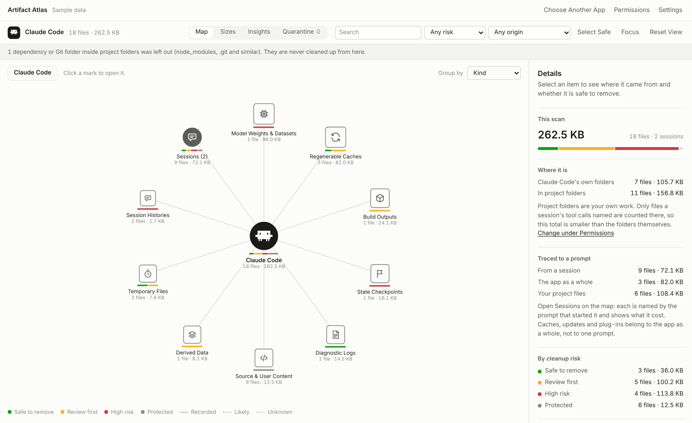

<p align="center">
  <picture>
    <source media="(prefers-color-scheme: dark)" srcset=".github/assets/mark-dark.svg" />
    
  </picture>
</p>

<h1 align="center">Artifact Atlas</h1>

<p align="center">
  <strong>Know which AI session made a file before you delete it.</strong><br />
  See everything Claude Code, Cursor, Codex and other AI apps leave on your Mac or PC,<br />
  traced to the prompt that made it, and remove the leftovers safely.
</p>

<p align="center">
  <a href="https://github.com/yazicmert/basket/releases/latest/download/ArtifactAtlas-macOS.dmg"><strong>Download for macOS</strong></a>
  &nbsp;·&nbsp;
  <a href="https://github.com/yazicmert/basket/releases/latest/download/ArtifactAtlas-Windows.zip"><strong>Download for Windows</strong></a>
  &nbsp;·&nbsp;
  <a href="https://yazicmert.github.io/basket/">Website</a>
</p>

<p align="center">
  <a href="https://github.com/yazicmert/basket/releases/latest"></a>
  
  <a href="LICENSE"></a>
</p>

<br />

<picture>
  <source media="(prefers-color-scheme: dark)" srcset=".github/assets/app-map-dark.png" />
  
</picture>

<br />

## Why

AI coding tools leave far more on disk than the code you asked for: installs, caches, logs, screenshots, worktrees and a record of every session. Most of it is never cleaned up, and nothing tells you which conversation made what. Artifact Atlas does.

## What you get

|  |  |
|---|---|
| **Every file, traced to its prompt** | Claude Code files are linked to the session and the tool call that wrote them. Cursor and Codex sessions show the prompt that started them. Any other app is found by its own data folders. |
| **What each prompt cost** | Each session shows what it left behind beyond the work it delivered, in files and bytes. |
| **A risk for every file** | Safe to remove, review first, high risk or protected, judged by where a file lives and how it is used. Never by its extension alone. |
| **Cleanup you can undo** | Files go to a Quarantine first and can be put back. Only files that waited 30 days are deleted, after you confirm the list. |
| **Insights over time** | What changed since the last scan, worktrees, build outputs, identical files, and a report you can keep. |

## Private by design

Artifact Atlas runs on your computer and reads nothing until you allow it. It never starts the apps it scans, never stores your conversations, and never ties a file to a session on a guess. There is no account and no telemetry; the only network use is the update check, which you can turn off. Read the [privacy policy](https://yazicmert.github.io/basket/legal/privacy/) and what each [permission](https://yazicmert.github.io/basket/permissions/) allows.

## Install

**macOS** 14 or later, Apple silicon. Open the [disk image](https://github.com/yazicmert/basket/releases/latest/download/ArtifactAtlas-macOS.dmg), drag the app into Applications, and on first launch choose **Open Anyway** in System Settings → Privacy & Security.

**Windows** 10 or 11. Extract the [ZIP](https://github.com/yazicmert/basket/releases/latest/download/ArtifactAtlas-Windows.zip) and start `ArtifactAtlas.exe`. At *Windows protected your PC*, choose **More info**, then **Run anyway**. Nothing is installed.

The builds are not yet notarized or signed with a certificate, which is why each system asks once. Every release lists the SHA-256 of its downloads, and the app updates itself in place when you click its update button.

## Run from source

Node.js 22.13 or newer, no dependencies.

```bash
git clone https://github.com/yazicmert/basket.git && cd basket
npm start    # the interface on http://127.0.0.1:4310
npm test     # runs on Linux, macOS and Windows
```

<details>
<summary>Command line and building the apps</summary>
<br />

**Command line.** `node src/cli.js quarantine <file> --app <app>` prints a review and a confirmation token; run it again with `--confirm <token>` to move the file. `node src/cli.js restore --list` lists the Quarantine.

**macOS** (14 or later, Xcode with Swift 5.10+)

```bash
swift test
npm run package:macos   # app, disk image, ZIP and SHA256SUMS.txt in dist/
npm run verify:macos    # mounts the disk image and checks it end to end
```

**Windows** (10 or 11, nothing extra installed)

```powershell
./scripts/package-windows.ps1        # runtime, ArtifactAtlas.exe, ZIP and its SHA-256
./scripts/verify-windows-bundle.ps1  # extracts the ZIP and checks it end to end
```

Continuous integration tests every change on Linux, Windows and macOS, including the in-place update on each system.

</details>

## More

[Architecture](ARCHITECTURE.md) · [Roadmap](ROADMAP.md) · [Contributing](CONTRIBUTING.md) · [Security](SECURITY.md) · [Terms](https://yazicmert.github.io/basket/legal/terms/)

<br />

<p align="center"><sub>MIT licensed · Not affiliated with the makers of the apps it scans.</sub></p>
