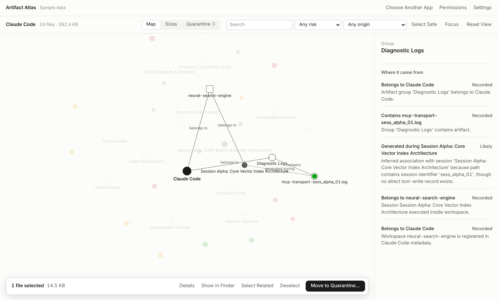

<div align="center">


# Artifact Atlas

**Know which AI session made a file before you delete it.**

[Website](https://yazicmert.github.io/basket/) · [Download for macOS](https://github.com/yazicmert/basket/releases/latest/download/ArtifactAtlas-macOS.dmg) · [Download for Windows](https://github.com/yazicmert/basket/releases/latest/download/ArtifactAtlas-Windows.zip) · [Releases](https://github.com/yazicmert/basket/releases)



</div>

---

AI coding tools leave far more on disk than the code you asked for: installs, caches, logs, screenshots, worktrees and their own records of every session. Artifact Atlas finds all of it, traces each file to the session and prompt that made it, tells you how safe it is to remove, and moves what you choose into a Quarantine you can restore from.

## What it does

- **Traces files to prompts.** For Claude Code, each file a session wrote is linked to that session and its tool call. Cursor and Codex sessions are listed with their starting prompt. Any other app is found by its own data folders.
- **Shows what a prompt cost.** Each session shows what it left beyond its output, in files and bytes.
- **Rates every file.** Safe to remove, review first, high risk or protected, judged by where a file lives and how it is used, never by its extension alone.
- **Cleans up safely.** Files go to a Quarantine first. Only files that have waited 30 days are deleted, after you confirm the list.
- **Keeps an eye on growth.** The Insights tab shows what changed since the last scan, worktrees, build outputs and identical files, and exports a report.

## Install

| | |
|---|---|
| **macOS** 14+, Apple silicon | Download the [disk image](https://github.com/yazicmert/basket/releases/latest/download/ArtifactAtlas-macOS.dmg), drag the app into Applications, and on first launch choose **Open Anyway** in System Settings → Privacy & Security. |
| **Windows** 10 or 11 | Download the [ZIP](https://github.com/yazicmert/basket/releases/latest/download/ArtifactAtlas-Windows.zip), extract it and start `ArtifactAtlas.exe`. At *Windows protected your PC*, choose **More info**, then **Run anyway**. Nothing is installed. |

Builds are not yet notarized or signed with a certificate, hence the extra step. Each release lists the SHA-256 of every download in `SHA256SUMS.txt`. The app updates itself in place when you click its update button, on both systems.

## Private by design

- **Reads, never runs.** Apps are identified from their metadata; nothing you scan is started.
- **Asks first.** Nothing on your disk is read until you allow it, and you choose what a scan counts. See [permissions](https://yazicmert.github.io/basket/permissions/).
- **Stays on your computer.** No account, no telemetry. The only network use is the update check, which you can turn off, and the download you click.
- **Never stores conversations.** A session's prompt is read from its own record when you open it, and never kept.
- **Never guesses a link.** A file is tied to a session only when the session's record names it.

[Privacy](https://yazicmert.github.io/basket/legal/privacy/) · [Terms](https://yazicmert.github.io/basket/legal/terms/) · [Notices](https://yazicmert.github.io/basket/legal/notices/)

## Run from source

Requires Node.js 22.13 or newer. There are no npm dependencies.

```bash
git clone https://github.com/yazicmert/basket.git
cd basket
npm start    # opens the interface on http://127.0.0.1:4310
npm test     # runs on Linux, macOS and Windows
```

The command line can also review, quarantine and restore files: `node src/cli.js quarantine <file> --app <app>` prints a review and a confirmation token, and `node src/cli.js restore --list` lists the Quarantine.

<details>
<summary><strong>Building the apps</strong></summary>

**macOS** (14+, Xcode with Swift 5.10+)

```bash
swift test
npm run package:macos   # app, DMG, ZIP and SHA256SUMS.txt in dist/
npm run verify:macos    # mounts the DMG and checks it end to end
```

With `APPLE_DEVELOPER_ID_APPLICATION`, `APPLE_ID`, `APPLE_TEAM_ID` and `APPLE_APP_SPECIFIC_PASSWORD` set, the build is signed with the Hardened Runtime and notarized.

**Windows** (10 or 11, nothing extra installed)

```powershell
./scripts/package-windows.ps1        # runtime, ArtifactAtlas.exe, ZIP and its SHA-256
./scripts/verify-windows-bundle.ps1  # extracts the ZIP and checks it end to end
```

**CI.** [`macos-build.yml`](.github/workflows/macos-build.yml) tests on Linux, Windows and macOS and builds both apps, including the in-place update on each system. [`macos-release.yml`](.github/workflows/macos-release.yml) publishes a release by hand. [`pages.yml`](.github/workflows/pages.yml) publishes the website.

</details>

## Learn more

- [Architecture](ARCHITECTURE.md): how scanning, provenance, classification and the Quarantine work
- [Roadmap](ROADMAP.md)
- [Rules for contributors and coding agents](AGENTS.md)

---

<div align="center"><sub>MIT licensed · Not affiliated with the makers of the apps it scans.</sub></div>
